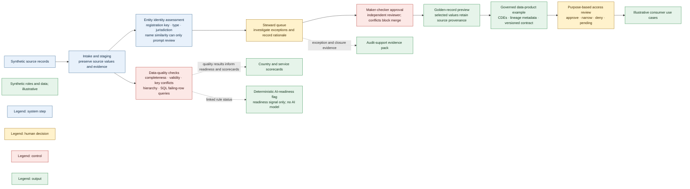

# Entity MDM and Governed Data Product Prototype

**Personal prototype · synthetic data · illustrative policies, targets and results.** This project demonstrates governed reference data from critical data element (CDE) through lineage, quality, access review and audit evidence. It is not based on or connected to any firm's systems, data, processes or approved policies. It is not production MDM, an access-control system, or regulatory guidance.

## What it demonstrates

- Explainable entity mastering, stewardship, conflict-safe survivorship and maker-checker examples.
- CDE registry, business glossary and source-to-target lineage with transformation notes and consumer links.
- A governed data-product catalogue and versioned illustrative contract, including schema, quality SLOs, refresh and change policy.
- Purpose-limited synthetic access requests with owner review, narrowing, denial reasons and pending status.
- Wealth client and account data with deterministic DQ rules, seeded rule tests, SQL failing-row queries, country scorecards and a plain-language executive summary.
- Synthetic service operations, multi-hub role coverage, handoffs, continuity scenarios and improvement backlog.
- An audit-support evidence pack and deterministic exception triage with prefilled evidence.

**Conceptual flow; the prototype implements each step separately.**



There is **no AI model**. The `AI-ready` label is a deterministic data-readiness flag: definition, complete lineage, named owner and passing linked rules. It is not a model feature. Manual-effort estimates and all targets/results are illustrative, not measured.

## Run locally

```powershell
python -m venv .venv
.\.venv\Scripts\Activate.ps1
pip install -e ".[dev]"
python -m mdm_prototype demo
python -m mdm_prototype evaluate
python -m mdm_prototype ops
python -m mdm_prototype ops --html
python -m mdm_prototype product
python -m mdm_prototype audit
python -m pytest -q
```

The dashboard is generated at `docs/mdm_operations.html`; the audit pack is generated under ignored `out/`. The example matching evaluation uses 20 author-labelled pairs developed with the rules and is not independent validation. Wealth DQ queries run against an in-memory SQLite snapshot.

## Repository map

- `data/mdm/` — synthetic entity and wealth records, CDEs, glossary, product contract, access queue, DQ rules/exceptions and operating model.
- `src/mdm_prototype/` — matching, deterministic scorecards, product readiness, SQL comparison, audit and CLI.
- `sql/dq_rules/` — readable entity and wealth-domain failing-row queries.
- `tests/` — deterministic behavior, evidence consistency, privacy boundary and generated-dashboard checks.
- `docs/PRODUCT.md` — product vision, users, roadmap, prioritisation and exclusions.
- `docs/ENTITY_MDM.md` — matching, survivorship and stewardship.
- `docs/MDM_OPERATIONS.md` — operations, quality, glossary, scorecards, audit and limitations.
- `docs/ARCHITECTURE.md` — code-grounded Mermaid views of implemented flows, controls, lineage and synthetic operating model.

## Boundaries

All organizations, people, identifiers, roles, hubs, data, thresholds, scorecard results, access decisions and effort estimates are synthetic or illustrative. There are no external feeds, real user authentication, access enforcement, workflow engine, automated ingestion, live system integration or ML matching. Continuity scenarios require tabletop validation. Regulatory relevance tags are illustrative mappings only and do not state regulatory requirements.
