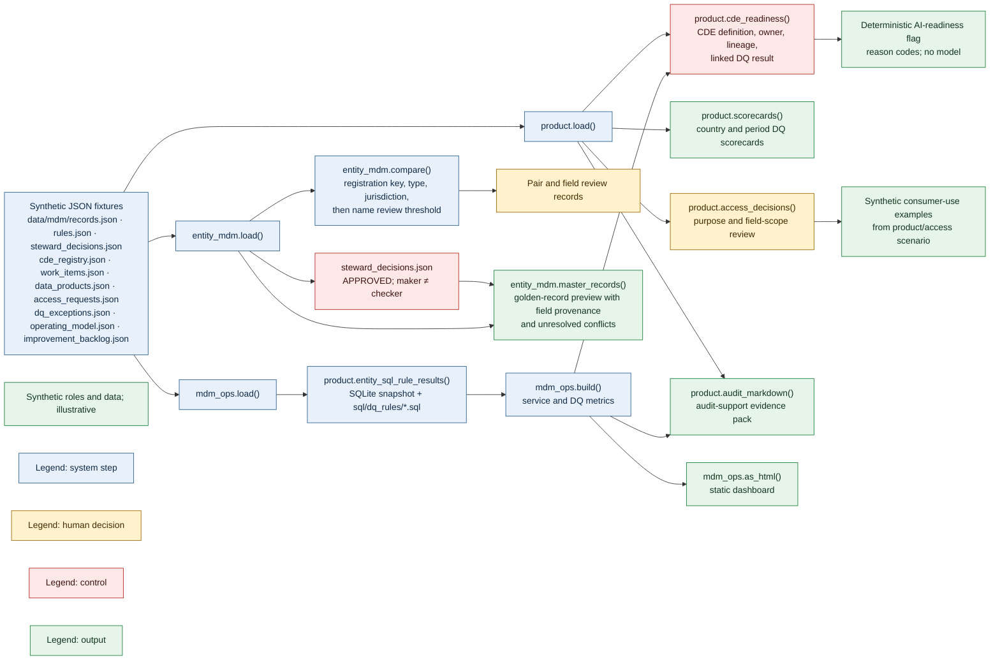
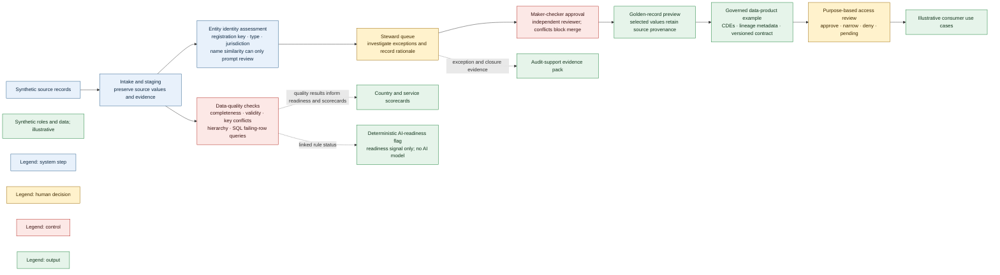
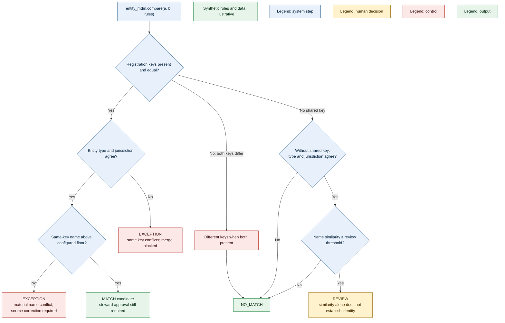
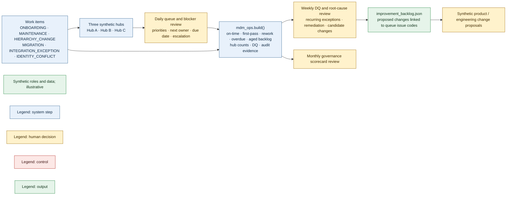
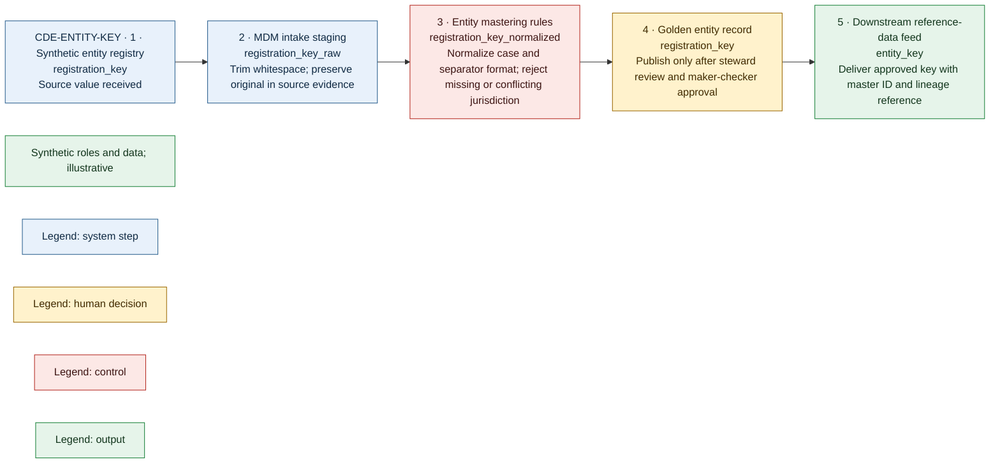
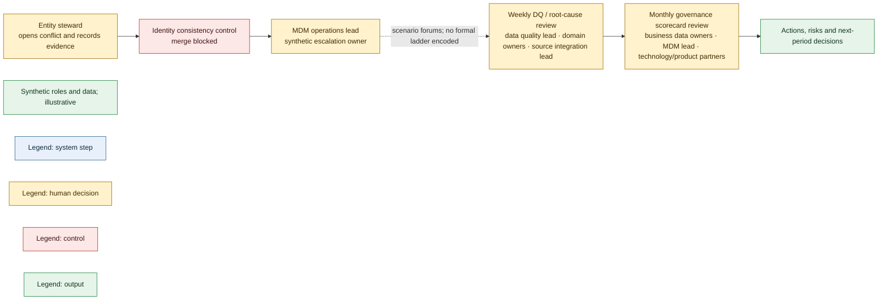

# Implemented architecture

These diagrams describe the current prototype and its checked-in synthetic scenario data. They do not describe a production deployment. The JSON snapshots are loaded locally; no live source feeds, workflow service, access enforcement, or inter-module pipeline is connected. In particular, SQL quality checks and entity matching are separate calculations, and the CDE lineage is registered metadata rather than an executed data pipeline.

## End-to-end system map

The modules read overlapping file-backed fixtures and produce separate outputs. Arrows show implemented input/output relationships, not an automated sequence between modules.

The side outputs are deliberately separate: country scorecards are rendered by the product/dashboard code; the audit pack is generated by the `audit` CLI command; and the AI-readiness flag is a deterministic CDE completeness check, not an AI feature. Access decisions are examples and are not enforced against consumers.

## Conceptual business flow

This is an business-level view of the governed-data journey, not a runtime pipeline. **The prototype implements each step separately** using synthetic fixtures and deterministic calculations. The registered lineage documents source-to-target hops; it does not mean those feeds are connected or executed.

This picture communicates the business concepts. In the code, DQ checks, match recommendations, stewardship decisions, golden-record preview, data-product metadata, access review and reporting are separate functions over synthetic JSON fixtures; arrows in this diagram are conceptual relationships, not automated handoffs.

## Match decision flow

## MDM service operating model

The queue snapshot contains six work types and cases assigned across three synthetic hubs. The queue/blocker review is daily. A separate weekly data-quality/root-cause review produces remediation actions and candidate product changes; monthly governance scorecard review covers quality, service trends, evidence and decisions.

## Registered lineage example: CDE-ENTITY-KEY

The five hops and transformations below are copied from the CDE registry. They document intended lineage for this synthetic CDE; the prototype does not execute the source-to-target feed.

## Recorded escalation and governance forums

The scenario data records a steward escalating an identity conflict to the MDM operations lead, plus weekly and monthly forums. It does not define a formal steward → data owner → governance forum → senior data owner escalation ladder, so that unimplemented chain is not depicted.

